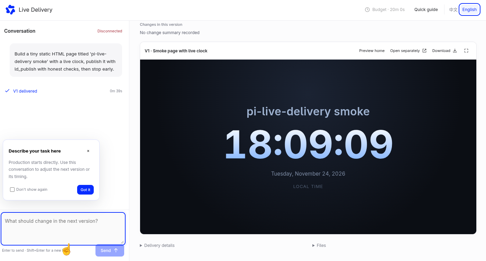

# pi-live-delivery



Long-running work without a black box. `pi-live-delivery` turns pi into a
**live delivery** assistant: it ships a usable version early, keeps delivering
as the task grows, and opens a browser workbench at any time to review
deliveries and steer the work — all inside the same pi session.

This is a pi package. It installs and runs alongside pi — it does not ship
its own agent or runtime.

## How it works

For a multi-hour task, pi is often asked to build something in one shot and
hand back a result at the end. `pi-live-delivery` changes that: the agent
publishes a small but usable artifact early, then iterates with a rolling
plan — every version has its own snapshot, a truthful check set, and an
explicit preview entry. At any time you can:

- open the workbench (a loopback HTTP page generated in your pi session),
- preview and download each version,
- send further requirements — they arrive as user feedback at the next turn
  boundary, without restarting the task,
- extend or stop the total time budget.

## What's in the package

**Skill** `go` (`/skill:go`) — how the agent is instructed to deliver:
choose a first usable milestone, publish it, keep delivering, revise from
evidence, verify before publishing. Loaded by pi from
`skills/go/SKILL.md`.

**Four tools**, registered in-process — no MCP server, no hooks, no binding
files:

| Tool | Purpose |
| --- | --- |
| `ld_begin` | start or attach a rolling delivery task; plan the first milestone |
| `ld_publish` | publish a usable version with snapshots and truthful checks |
| `ld_status` | read the plan, remaining budget, publications, feedback and stop state |
| `ld_done` | finish the task on wrap-up or budget exhaustion |

**Workbench** — a loopback-only HTTP page (ephemeral port, per-session
access token in the URL fragment) served by the same process that runs pi's
tools. It renders the task plan, your deliveries with inline previews, and
accepts feedback, budget changes, and a wrap-up signal. Resumed sessions
keep their task and feedback — the workbench lives in the project's
`.live-delivery/` state.

## Install

```bash
pi install npm:pi-live-delivery
```

or install from git:

```bash
pi install git:github.com/senordeveloper/pi-live-delivery
```

or use it for a single invocation:

```bash
pi -e ./extensions/live-delivery.ts
```

Optional gallery previews come from the `pi.image` field (the banner above).

## Usage

1. Start pi in a project (or a single workspace). On session start, the
   extension prints a **Delivery workbench** URL in the footer.
2. Ask pi for a task you want delivered — e.g. "build an offline game page".
   The `go` skill loads, and pi uses `ld_begin` to plan the first milestone.
3. Watch the versions land in the workbench; add requirements in chat or
   directly in the workbench (they arrive as feedback at the next turn).
4. Stop the task with a **wrap-up** (or budget exhaustion); the latest
   published version is preserved.

## Security & trust

The workbench binds to `127.0.0.1` only and serves an ephemeral port. Its
access is controlled by a per-session random token held in the URL fragment —
never in `.live-delivery/` or any artifact. Keep the URL private.

The extension runs inside pi with pi's own permissions, and pi executes the
tool calls it registers. Only install packages you trust — review
`resources/live-delivery/` and `extensions/` before installing.

## Origin

The delivery engine is adapted from the upstream
**[Qwen Live Delivery Plugin](https://github.com/QwenLM/Qwen-Live-Delivery-Plugin)**
(QwenLM, Apache-2.0) — a plugin for Codex CLI and Qwen Code CLI. This package
is a pi-native port: same delivery engine, views, feedback, and budgeting
semantics re-hosted in pi — no MCP server, no hooks. The engine tree under
`resources/live-delivery/` is a **one-way copy** of the upstream sources,
imported unmodified and verified against the upstream test suite. Do not
edit it in place — re-sync from upstream and re-test.

Upstream credit and LICENSE: Apache-2.0 (`LICENSE`). Package author: Daniel
(senordeveloper). This is not an official QwenLM package.

## Maintainers

```bash
npm install --legacy-peer-deps
npm pack --dry-run   # verify the published tarball
```

Host-provided pi packages (`typebox`, `@earendil-works/pi-coding-agent`) are
peer dependencies — keep them out of `dependencies` and never bundle them.

## License

Apache-2.0 (see `LICENSE`). The delivery engine derives from the Apache-2.0
[Qwen-Live-Delivery-Plugin](https://github.com/QwenLM/Qwen-Live-Delivery-Plugin).
